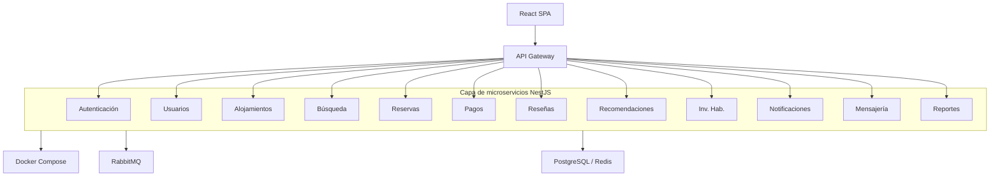
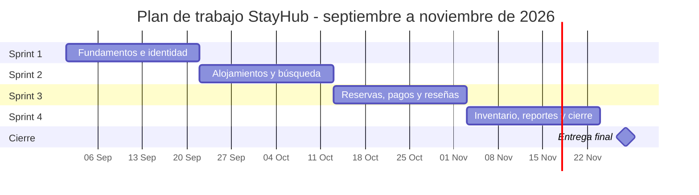

# Plan de Trabajo

## Plataforma de Alojamientos y Hoteles

### Arquitectura de Microservicios

| Campo | Valor |
|---|---|
| **Proyecto** | StayHub (nombre provisional) |
| **Modalidad** | Desarrollo ágil - 4 Sprints |
| **Seguimiento** | GitHub Projects |
| **Inicio** | 1 de septiembre de 2026 |
| **Entrega final** | 28 de noviembre de 2026 |
| **Duración** | 13 semanas |
| **Backend** | NestJS (TypeScript) |
| **Frontend** | React (TypeScript) |

### Integrantes

- Javier Alejandro Penagos Hernández
- Nicolás Felipe Corredor Cortés
- Daniel Fernando Romero Ochoa
- Janeth Oliveros Ramírez
- Juan David Palacios
- Juan Pablo Bustos Urueña

**Fecha del documento:** 25 de septiembre de 2026

---

## Índice

1. [Introducción](#1-introducción)
2. [Requerimientos](#2-requerimientos)
3. [Arquitectura del sistema](#3-arquitectura-del-sistema)
4. [Planificación por Sprints](#4-planificación-por-sprints)
5. [Diagrama de Gantt](#5-diagrama-de-gantt)
6. [Riesgos y mitigación](#6-riesgos-y-mitigación)
7. [Equipo de trabajo](#7-equipo-de-trabajo)
8. [Definición de Terminado (DoD)](#8-definición-de-terminado-dod)

---

# 1. Introducción

StayHub es una plataforma de reservas de alojamientos y hoteles, inspirada en el modelo de Airbnb y orientada al sector hotelero. El presente documento define el plan de trabajo, los requerimientos funcionales y no funcionales, la arquitectura de microservicios y la planificación por sprints para su desarrollo. El seguimiento del proyecto se realizará a través de **GitHub Projects**, donde el equipo gestionará tareas, sprints y el estado de los entregables.

## 1.1. Objetivo general

El objetivo del proyecto es construir una plataforma web que permita a propietarios y administradores de hoteles tanto publicar como gestionar alojamientos, y a huéspedes buscar, reservar, pagar y calificar propiedades, utilizando una arquitectura de **microservicios** con **NestJS** en el backend y **React** en el frontend, desplegada con **Docker**.

## 1.2. Alcance

Al finalizar los cuatro sprints planificados, el producto mínimo viable (MVP) incluirá:

- Registro, autenticación y gestión de perfiles de usuarios con roles (huésped, propietario, administrador).
- Publicación y administración de hoteles, habitaciones, fotos, precios y características.
- Búsqueda avanzada con filtros y palabras clave.
- Flujo completo de reservas: disponibilidad, confirmación, cancelación y check-in/out.
- Procesamiento de pagos y reembolsos.
- Sistema de reseñas y calificaciones.
- Inventario de habitaciones y servicios del alojamiento.
- Notificaciones y mensajería entre huésped y alojamiento.
- Panel estadístico administrativo y recomendaciones personalizadas.

# 2. Requerimientos

Este capítulo consolida las necesidades del sistema en requerimientos funcionales y no funcionales. Cada requerimiento funcional se identifica con un código único (RQ-XX) para facilitar su trazabilidad durante el desarrollo y las pruebas.

## 2.1. Requerimientos funcionales

Los requerimientos funcionales describen las capacidades que el sistema debe ofrecer a sus usuarios: huéspedes, propietarios y administradores. A continuación se detallan los trece requerimientos priorizados para el MVP.

| ID | Nombre | Descripción |
|---|---|---|
| **RQ-01** | Edición del perfil de usuario | El usuario autenticado puede actualizar su nombre, correo, teléfono, foto de perfil y preferencias. El servicio de Usuarios valida los datos y persiste los cambios. |
| **RQ-02** | Crear usuario | El sistema permite registrar nuevos usuarios con datos básicos (nombre, correo y contraseña) y asignar un rol (huésped, propietario o administrador). Los servicios de Autenticación y Usuarios validan la información, cifran la contraseña y persisten el registro. |
| **RQ-03** | Editar propiedad | El propietario puede modificar nombre, descripción, ubicación, precios, características, fotos y disponibilidad de sus alojamientos publicados. |
| **RQ-04** | Buscar propiedad | El huésped puede buscar alojamientos por ubicación, rango de precios, fechas de entrada/salida, capacidad, amenidades y palabras clave. Los resultados se ordenan por relevancia. |
| **RQ-05** | Publicar propiedad | El propietario registrado puede crear y publicar un nuevo alojamiento con habitaciones, fotos, precios y características. La propiedad queda visible tras validación básica. |
| **RQ-06** | Ver detalles de una propiedad | Cualquier usuario puede consultar la ficha completa de un alojamiento: fotos, descripción, precio, disponibilidad, reseñas y mapa de ubicación. |
| **RQ-07** | Reservar una propiedad | El huésped autenticado selecciona fechas, habitación y confirma la reserva. El sistema verifica disponibilidad, calcula el total y genera la orden de pago. |
| **RQ-08** | Histórico de reservas de mis propiedades | El propietario accede a un listado de todas las reservas recibidas en sus propiedades, con filtros por fecha, estado y huésped. |
| **RQ-09** | Cancelar reserva (huésped) | El huésped puede cancelar una reserva activa dentro de la política de cancelación. Se libera la disponibilidad y se inicia el reembolso si aplica. |
| **RQ-10** | Cancelar reserva (propietario) | El propietario puede cancelar una reserva con justificación. Se notifica al huésped y se procesa el reembolso completo. |
| **RQ-11** | Calificar la propiedad | Tras completar una estadía, el huésped puede dejar una calificación (1-5 estrellas) y un comentario sobre la propiedad. |
| **RQ-12** | Panel estadístico administrativo | El propietario/administrador visualiza métricas de reservas, ingresos, tasa de ocupación, cancelaciones y tendencias en un dashboard. |
| **RQ-13** | Recomendaciones de propiedades | El sistema sugiere alojamientos al huésped según su historial de búsquedas, reservas previas, ubicaciones favoritas y propiedades similares. |

*Cuadro 1: Requerimientos funcionales.*

## 2.2. Requerimientos no funcionales

Los requerimientos no funcionales establecen las condiciones de calidad bajo las cuales el sistema debe operar. Definen estándares de rendimiento, seguridad, mantenibilidad y portabilidad que aplican a todos los microservicios.

| Categoría | Descripción |
|---|---|
| **Rendimiento** | Tiempo de respuesta < 500 ms en el 95 % de las peticiones de búsqueda y consulta. |
| **Escalabilidad** | Cada microservicio puede escalarse de forma independiente mediante réplicas Docker. |
| **Disponibilidad** | Los servicios críticos (`auth`, `bookings`, `payments`) deben reiniciarse automáticamente con `restart: always`. |
| **Seguridad** | Autenticación JWT, HTTPS en gateway, validación de roles y sanitización de entradas. |
| **Mantenibilidad** | Código modular en TypeScript (NestJS + React), documentación OpenAPI por servicio y logs centralizados. |
| **Portabilidad** | Todo el stack corre con `docker compose up` en cualquier máquina con Docker instalado. |
| **Comunicación** | REST para operaciones síncronas; RabbitMQ para eventos (reserva creada, pago confirmado, etc.). |

*Cuadro 2: Requerimientos no funcionales.*

# 3. Arquitectura del sistema

La arquitectura se fundamenta en el desacoplamiento de responsabilidades, permitiendo que cada componente evolucione, despliegue y escale de forma independiente. La plataforma adopta una arquitectura de microservicios desacoplados, donde cada dominio de negocio es un servicio independiente desarrollado con **NestJS** y su propia base de datos. El cliente web es una aplicación **React (SPA)** que consume las APIs a través de un **API Gateway**. Los servicios se comunican mediante API REST (síncrona) y eventos de mensajería (asíncrona) a través de un **Message Broker**.

*Figura 1: Diagrama de arquitectura de la plataforma StayHub.*

## 3.1. Stack tecnológico

La selección de tecnologías busca unificar el lenguaje de programación (TypeScript), facilitar el desarrollo en equipo y garantizar la portabilidad del sistema mediante contenedores Docker.

| Capa | Tecnología | Uso en el proyecto |
|---|---|---|
| Frontend | React 18 + TypeScript | Interfaz de usuario: búsqueda, reservas, panel del propietario, dashboard y mensajería. |
| Frontend | Vite | Bundler y entorno de desarrollo del frontend. |
| Frontend | React Router | Navegación entre vistas (públicas, huésped, propietario, admin). |
| Frontend | Axios / React Query | Consumo de APIs REST y gestión de estado del servidor. |
| Backend | NestJS 10 + TypeScript | Implementación de los 12 microservicios con módulos, controladores y servicios. |
| Backend | TypeORM / Prisma | ORM para persistencia en PostgreSQL por servicio. |
| Backend | Passport + JWT | Autenticación y autorización en `auth-service`. |
| Backend | `@nestjs/microservices` | Comunicación asíncrona con RabbitMQ entre servicios. |
| Backend | Swagger (`@nestjs/swagger`) | Documentación automática de APIs (OpenAPI). |
| Infraestructura | Docker + Docker Compose | Contenedorización y orquestación de todos los servicios. |
| Infraestructura | PostgreSQL 16 | Base de datos relacional (una instancia por microservicio). |
| Infraestructura | Redis 7 | Caché de sesiones, búsquedas frecuentes y resultados de consulta en `search-service`. |
| Infraestructura | RabbitMQ 3 | Message broker para eventos (reserva creada, pago confirmado, etc.). |
| Infraestructura | Nginx / Kong | API Gateway: enrutamiento, SSL y balanceo de carga. |

*Cuadro 3: Stack tecnológico de la plataforma.*

## 3.2. Microservicios

Cada microservicio representa un dominio de negocio con responsabilidades bien definidas, su propia base de datos y endpoints REST documentados. La tabla siguiente resume los doce servicios que componen la plataforma.

| Servicio | Responsabilidad | Endpoints principales |
|---|---|---|
| `auth-service` | Autenticación, emisión y validación de JWT, permisos y seguridad. | `POST /auth/login` `POST /auth/register` `POST /auth/refresh` `GET /auth/validate` |
| `users-service` | Registro de usuarios, perfiles, roles (huésped, propietario, admin) y edición de datos personales. | `GET /users/:id` `PUT /users/:id` `GET /users/:id/profile` `PUT /users/:id/profile` |
| `accommodations-service` | Gestión de hoteles, habitaciones, fotos, precios, características y publicación de propiedades. | `POST /properties` `PUT /properties/:id` `GET /properties/:id` `POST /properties/:id/photos` |
| `search-service` | Búsqueda de alojamientos por ubicación, precio, fechas, capacidad, keywords y filtros combinados. | `GET /search` `GET /search/suggest` |
| `bookings-service` | Disponibilidad, creación de reservas, cancelaciones (huésped y propietario), check-in/out e historial. | `POST /bookings` `GET /bookings/:id` `DELETE /bookings/:id` `GET /bookings/history` |
| `payments-service` | Procesamiento de pagos, reembolsos y consulta de estados de transacciones. | `POST /payments` `POST /payments/:id/refund` `GET /payments/:id/status` |
| `reviews-service` | Calificaciones y comentarios de huéspedes sobre propiedades visitadas. | `POST /reviews` `GET /properties/:id/reviews` `GET /reviews/user/:id` |
| `room-inventory-service` | Control de productos y servicios disponibles en cada habitación o alojamiento. | `GET /inventory/rooms/:id` `PUT /inventory/rooms/:id` `POST /inventory/rooms/:id/items` |
| `notifications-service` | Confirmaciones de reserva, recordatorios de check-in y alertas del sistema. | `POST /notifications/send` `GET /notifications/user/:id` |
| `messaging-service` | Comunicación en tiempo real o asíncrona entre huésped y propietario o alojamiento. | `POST /messages` `GET /conversations/:id` `GET /messages/:conversationId` |
| `reports-service` | Panel estadístico: reservas, ingresos, ocupación, tendencias y métricas por propietario. | `GET /reports/owner/:id` `GET /reports/occupancy` `GET /reports/revenue` |
| `recommendations-service` | Recomendaciones de propiedades según historial, preferencias y comportamiento del cliente. | `GET /recommendations/user/:id` `GET /recommendations/similar/:propertyId` |

*Cuadro 4: Microservicios de la plataforma.*

## 3.3. Infraestructura Docker

La contenedorización permite que todo el ecosistema de la aplicación se levante de forma reproducible en cualquier entorno de desarrollo con un único comando. Cada microservicio NestJS y la aplicación React se empaquetan en contenedores Docker independientes. Un archivo `docker-compose.yml` orquesta todos los servicios, bases de datos y componentes de infraestructura.

| Contenedor | Imagen / Tecnología | Puerto |
|---|---|---:|
| web (frontend) | React + Vite (Node 20) | 5173 |
| API Gateway | NestJS / Nginx | 8080 |
| auth-service | NestJS | 3001 |
| users-service | NestJS | 3002 |
| accommodations-service | NestJS | 3003 |
| search-service | NestJS | 3004 |
| bookings-service | NestJS | 3005 |
| payments-service | NestJS | 3006 |
| reviews-service | NestJS | 3007 |
| room-inventory-service | NestJS | 3008 |
| notifications-service | NestJS | 3009 |
| messaging-service | NestJS + Socket.io | 3010 |
| reports-service | NestJS | 3011 |
| recommendations-service | NestJS | 3012 |
| PostgreSQL (por servicio) | postgres:16 | 5432-5445 |
| Redis | redis:7 | 6379 |
| RabbitMQ | rabbitmq:3-management | 5672 / 15672 |

*Cuadro 5: Componentes de infraestructura Docker.*

Cada servicio NestJS escucha activamente en su puerto asignado y responde a las peticiones del API Gateway o de otros servicios según la necesidad del flujo de negocio. El frontend React se sirve en desarrollo con Vite y en producción como build estático detrás de Nginx.

# 4. Planificación por Sprints

El desarrollo se organiza en cuatro sprints de tres semanas con entregables incrementales, desde la infraestructura base hasta la integración completa de la plataforma. Cada sprint tiene un objetivo claro, tareas estimadas y criterios de aceptación definidos. El avance de las tareas y entregables se dará seguimiento en GitHub Projects.

## 4.1. Resumen del cronograma

El proyecto contempla doce semanas de desarrollo distribuidas en cuatro sprints de tres semanas, seguidas de un período de cierre y entrega final el 28 de noviembre de 2026.

| Sprint | Nombre | Inicio | Fin |
|---|---|---|---|
| Sprint 1 | Fundamentos e identidad | 01 Sep 2026 | 21 Sep 2026 |
| Sprint 2 | Alojamientos y búsqueda | 22 Sep 2026 | 12 Oct 2026 |
| Sprint 3 | Reservas, pagos y reseñas | 13 Oct 2026 | 02 Nov 2026 |
| Sprint 4 | Inventario, reportes y cierre | 03 Nov 2026 | 23 Nov 2026 |

**Entrega final (cierre):** 24-28 de noviembre de 2026.

*Cuadro 6: Cronograma de los 4 sprints.*

## 4.2. Sprint 1: Fundamentos e identidad

El primer sprint sienta las bases técnicas del proyecto. Se configura el entorno de desarrollo, la infraestructura Docker y los servicios esenciales de autenticación y gestión de usuarios.

**Duración:** 3 semanas (01-21 de septiembre de 2026).

**Objetivo:** Establecer la infraestructura base con Docker, el monorepo NestJS + React, implementar autenticación, gestión de usuarios y edición de perfiles.

**Entregables:**

- Monorepo con estructura `apps/` (microservicios NestJS + frontend React con Vite).
- `docker-compose.yml` con servicios base, PostgreSQL y RabbitMQ.
- API Gateway NestJS configurado y enrutando peticiones.
- `auth-service` (NestJS): registro, login, refresh token, validación JWT con Passport.
- `users-service` (NestJS): CRUD de usuarios, perfiles y roles.
- Frontend React: layout base, rutas, pantallas de login, registro y edición de perfil.
- Implementación de **RQ-01** y **RQ-02**.

| Tarea | Est. (h) | Resp. | Servicio |
|---|---:|---|---|
| Configurar monorepo NestJS + React (Vite) | 6 | DevOps | - |
| Scaffold frontend React (routing, layout) | 8 | Frontend | web |
| Diseñar esquema de BD usuarios/auth | 4 | Backend | auth, users |
| Implementar auth-service NestJS (JWT) | 16 | Backend | auth |
| Implementar users-service NestJS (perfil) | 12 | Backend | users |
| Pantallas React: login, registro, perfil | 10 | Frontend | web |
| Configurar Docker Compose inicial | 8 | DevOps | infra |
| Configurar API Gateway NestJS | 8 | DevOps | gateway |
| Pruebas unitarias e integración Sprint 1 | 8 | QA | todos |
| **Total estimado** | **80** | | |

*Cuadro 7: Tareas del Sprint 1.*

**Criterios de aceptación:**

- Un usuario puede registrarse e iniciar sesión desde la interfaz React.
- El usuario autenticado puede editar su perfil desde React consumiendo `users-service`.
- Los tokens JWT se validan correctamente en rutas protegidas de NestJS.
- Todos los servicios del sprint levantan con `docker compose up`.

## 4.3. Sprint 2: Alojamientos y búsqueda

En este sprint se habilita el ciclo de vida de las propiedades: publicación, actualización, consulta y búsqueda. Es el primer contacto del huésped con el catálogo de alojamientos disponibles.

**Duración:** 3 semanas (22 de septiembre-12 de octubre de 2026).

**Objetivo:** Permitir la publicación, actualización y consulta de propiedades, junto con un motor de búsqueda con filtros.

**Entregables:**

- `accommodations-service` (NestJS): hoteles, habitaciones, fotos, precios, características.
- `search-service` (NestJS): búsqueda por ubicación, precio, fechas, capacidad y keywords mediante consultas en PostgreSQL.
- Frontend React: búsqueda con filtros, listado de resultados, detalle de propiedad y formulario de publicación.
- Implementación de **RQ-03**, **RQ-04**, **RQ-05** y **RQ-06**.

| Tarea | Est. (h) | Resp. | Servicio |
|---|---:|---|---|
| Modelar entidades: hotel, habitación, foto | 6 | Backend | accommodations |
| Implementar CRUD propiedades (NestJS) | 16 | Backend | accommodations |
| Subida y almacenamiento de fotos | 8 | Backend | accommodations |
| Implementar búsqueda con filtros (PostgreSQL) | 12 | Backend | search |
| Implementar keywords y caché (Redis) | 8 | Backend | search |
| Vista React: búsqueda y resultados | 10 | Frontend | web |
| Vista React: detalle y publicar propiedad | 12 | Frontend | web |
| Pruebas e integración Sprint 2 | 10 | QA | todos |
| **Total estimado** | **82** | | |

*Cuadro 8: Tareas del Sprint 2.*

**Criterios de aceptación:**

- Un propietario puede publicar y actualizar una propiedad con fotos.
- Un huésped puede buscar propiedades con múltiples filtros y ver el detalle completo.
- Los resultados de búsqueda responden en menos de 500 ms.

## 4.4. Sprint 3: Reservas, pagos y reseñas

Este sprint implementa el flujo de negocio central de la plataforma: reservar un alojamiento, procesar el pago, gestionar cancelaciones y permitir que los huéspedes califiquen su experiencia.

**Duración:** 3 semanas (13 de octubre-02 de noviembre de 2026).

**Objetivo:** Implementar el flujo completo de reservas con pagos, cancelaciones, historial y sistema de calificaciones.

**Entregables:**

- `bookings-service` (NestJS): disponibilidad, reservas, cancelaciones, check-in/out.
- `payments-service` (NestJS): procesamiento de pagos, reembolsos y estados.
- `reviews-service` (NestJS): calificaciones y comentarios.
- `notifications-service` (NestJS): confirmaciones y alertas de reserva.
- Frontend React: flujo de reserva, historial, cancelaciones y formulario de reseñas.
- Implementación de **RQ-07**, **RQ-08**, **RQ-09**, **RQ-10** y **RQ-11**.

| Tarea | Est. (h) | Resp. | Servicio |
|---|---:|---|---|
| Lógica de disponibilidad y reservas (NestJS) | 16 | Backend | bookings |
| Cancelación huésped y propietario | 10 | Backend | bookings |
| Historial de reservas del propietario | 6 | Backend | bookings |
| Integración mock de pasarela de pago | 12 | Backend | payments |
| Flujo de reembolsos | 8 | Backend | payments |
| Sistema de reseñas y calificaciones | 10 | Backend | reviews |
| Notificaciones de reserva (email/eventos) | 8 | Backend | notifications |
| Eventos asíncronos con RabbitMQ (`@nestjs`) | 8 | Backend | todos |
| Vistas React: reservar, historial, cancelar | 14 | Frontend | web |
| Vista React: calificar propiedad | 6 | Frontend | web |
| Pruebas end-to-end del flujo de reserva | 12 | QA | todos |
| **Total estimado** | **110** | | |

*Cuadro 9: Tareas del Sprint 3.*

**Criterios de aceptación:**

- Un huésped puede reservar, pagar y recibir confirmación.
- Huésped y propietario pueden cancelar reservas según las políticas definidas.
- El propietario ve el historial de reservas de sus propiedades.
- Tras la estadía, el huésped puede calificar la propiedad.

## 4.5. Sprint 4: Inventario, reportes, recomendaciones y cierre

El último sprint completa las funcionalidades complementarias y prepara la entrega final. Se integran inventario de habitaciones, mensajería, reportes, recomendaciones y se realizan las pruebas de cierre del proyecto.

**Duración:** 3 semanas (03-23 de noviembre de 2026). **Entrega final:** 28 de noviembre de 2026.

**Objetivo:** Completar los servicios de inventario de habitaciones, mensajería, reportes, recomendaciones y realizar pruebas integrales de la plataforma.

**Entregables:**

- `room-inventory-service` (NestJS).
- `messaging-service` (NestJS + Socket.io): chat huésped-propietario.
- `reports-service` (NestJS): dashboard estadístico.
- `recommendations-service` (NestJS): sugerencias personalizadas.
- Frontend React: panel administrativo, inventario de habitaciones, mensajería y recomendaciones.
- Implementación de **RQ-12** y **RQ-13**.
- Pruebas de integración, documentación final y demo.

| Tarea | Est. (h) | Resp. | Servicio |
|---|---:|---|---|
| Inventario de habitaciones (NestJS) | 10 | Backend | room-inventory |
| Mensajería con WebSockets (NestJS Gateway) | 14 | Backend | messaging |
| Dashboard de reportes (NestJS) | 16 | Backend | reports |
| Motor de recomendaciones básico | 12 | Backend | recommendations |
| Panel React: estadísticas y gráficos | 14 | Frontend | web |
| Vistas React: inventario y mensajería | 12 | Frontend | web |
| Vista React: recomendaciones personalizadas | 8 | Frontend | web |
| Pruebas de carga y estrés básicas | 8 | QA | infra |
| Documentación API (Swagger en NestJS) | 8 | Todos | todos |
| Corrección de bugs y refinamiento | 12 | Todos | todos |
| Preparación de demo y entrega final | 6 | Todos | - |
| **Total estimado** | **120** | | |

*Cuadro 10: Tareas del Sprint 4.*

**Criterios de aceptación:**

- El propietario visualiza estadísticas de ocupación e ingresos en el panel.
- El huésped recibe recomendaciones personalizadas de propiedades.
- El inventario de habitaciones se actualiza correctamente.
- La plataforma completa funciona con `docker compose up` sin errores.
- Documentación entregada y demo funcional realizada.

# 5. Diagrama de Gantt

El diagrama de Gantt ofrece una visión temporal del proyecto, mostrando la distribución de los cuatro sprints de tres semanas y el período de cierre hasta la entrega final.

# 6. Riesgos y mitigación

La identificación temprana de riesgos permite anticipar problemas que podrían afectar el cronograma o la calidad del producto. A continuación se presentan los principales riesgos del proyecto junto con sus estrategias de mitigación.

| Riesgo | Prob. | Impacto | Mitigación |
|---|---|---|---|
| Complejidad de integración entre 12 servicios | Alta | Alto | API Gateway centralizado, contratos OpenAPI y pruebas de integración continuas. |
| Retrasos en Sprint 3 (flujo de reservas) | Media | Alto | Priorizar MVP del flujo de reserva; posponer check-in/out avanzado si es necesario. |
| Problemas de rendimiento en búsqueda | Media | Medio | Índices en PostgreSQL y caché con Redis. |
| Falta de experiencia con Docker | Baja | Medio | Sprint 1 dedicado a infraestructura; documentar setup paso a paso. |
| Scope creep en inventario de habitaciones | Media | Medio | Definir MVP mínimo; funcionalidades avanzadas quedan para fase 2. |

*Cuadro 11: Matriz de riesgos.*

# 7. Equipo de trabajo

El éxito del proyecto depende de la distribución clara de roles y responsabilidades. El equipo está conformado por seis integrantes con perfiles de backend, frontend, fullstack y aseguramiento de calidad.

| Área | Integrantes | Responsabilidades |
|---|---|---|
| **Backend** | Javier Alejandro Penagos Hernández Juan Pablo Bustos Urueña Juan David Palacios (apoyo) | Microservicios NestJS, TypeORM/Prisma, RabbitMQ, API Gateway y lógica de negocio. |
| **Frontend** | Nicolás Felipe Corredor Cortés Janeth Oliveros Ramírez Juan David Palacios (apoyo) | SPA React con Vite, React Router, consumo de APIs, dashboards y vistas de usuario. |
| **QA** | Daniel Fernando Romero Ochoa | Pruebas unitarias, de integración y end-to-end; validación de criterios de aceptación. |

*Cuadro 12: Composición del equipo.*

# 8. Definición de Terminado (DoD)

La Definición de Terminado establece los criterios mínimos que debe cumplir cualquier ítem del backlog para considerarse completado. Estos estándares aplican de forma uniforme a todo el equipo durante los cuatro sprints.

Un ítem del backlog se considera **terminado** cuando:

1. El código está en la rama principal (`main`) y pasa el pipeline de CI.
2. Existen pruebas unitarias con cobertura mínima del 70 % (Jest en NestJS y React).
3. La API NestJS está documentada con Swagger/OpenAPI.
4. El servicio corre en Docker sin errores; el frontend React compila sin warnings críticos.
5. Ha sido revisado por al menos otro miembro del equipo (code review).
6. Los criterios de aceptación del requerimiento asociado se cumplen.
